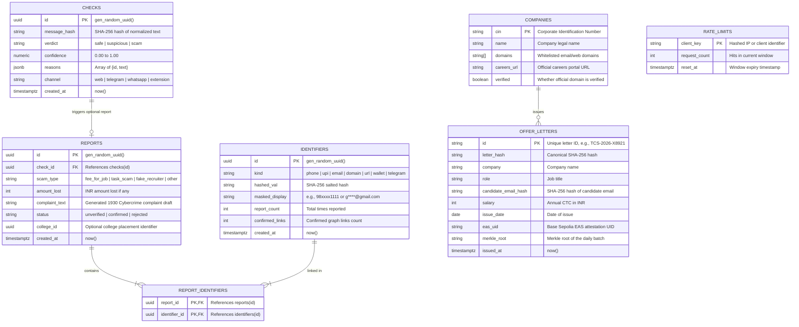
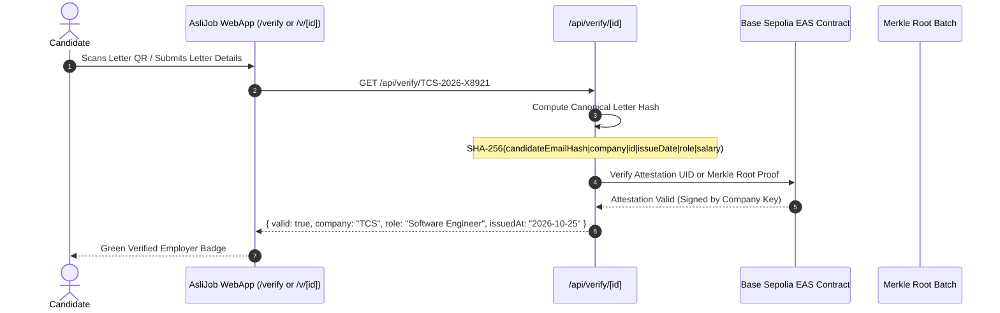

# AsliJob — Entity-Relationship Diagram & Data Architecture

This document specifies the complete data model for **AsliJob**, covering:
1. **Relational Data Layer** (Supabase Postgres with Row Level Security)
2. **Graph Data Layer** (TigerGraph Fraud Graph)
3. **Onchain Attestation Layer** (Base Sepolia EAS + Daily Merkle Batches)
4. **Privacy & Cryptographic Guarantees**

---

## 1. Complete Entity-Relationship Diagram



---

## 2. Fraud Graph Schema (TigerGraph)

While Postgres acts as the relational source of truth, the fraud graph captures multi-hop networks to detect syndicated scam gangs before individual numbers accumulate multiple direct reports.

```mermaid
graph TD
    subgraph TigerGraph FraudGraph
        V_Report["Vertex: Report<br/>• id: STRING<br/>• status: STRING ('unverified'|'confirmed')<br/>• scam_type: STRING<br/>• city: STRING<br/>• created_at: STRING"]
        V_Identifier["Vertex: Identifier<br/>• id: STRING ('kind:hash')<br/>• kind: STRING<br/>• hashed_val: STRING<br/>• masked_display: STRING"]

        V_Report ---|REPORT_IDENTIFIER (Undirected)| V_Identifier
    end
```

### 2-Hop Traversal Risk Semantics
When an incoming check extracts a seed identifier (e.g., Phone `P1`):
1. **Hop 0 (Seed):** Locate vertex `Identifier(P1)`.
2. **Hop 1 (Direct Reports):** Find all `Report` vertices linked to `P1`.
3. **Hop 2 (Co-occurring Identifiers):** Find all other `Identifier` vertices (e.g., UPI `U1`, Domain `D1`) co-reported in Hop 1 reports.
4. **Hop 3 (Network Reports):** Traverse to all `Report` vertices sharing Hop 2 identifiers.

**Risk Calculation:**
$$\text{confirmedLinks} = \text{Count of confirmed reports within 2 hops}$$
$$\text{reportedCount} = \text{Total reports linked to target identifier}$$
$$\text{cities} = \text{Count of unique cities impacted}$$

- **`confirmedLinks >= 2`** $\rightarrow$ Escalates verdict to **Scam**.
- **`reportedCount >= 1`** $\rightarrow$ Triggers warning badge with exact count.
- **`reportedCount == 1`** $\rightarrow$ **Never** marks as "Scam" alone without corroborating fee or domain red flags (prevents over-accusation).

---

## 3. Onchain Offer Letter Verification Model



### Canonical Letter Hash Calculation
To ensure deterministic verification without leaking candidate privacy:
1. `candidateEmail` is hashed: `candidateEmailHash = sha256(email.trim().toLowerCase())`
2. Fields are formatted in alphabetical order:
   ```
   candidateEmailHash:<hash>|company:<company>|id:<id>|issueDate:<date>|role:<role>|salary:<salary>
   ```
3. Final letter hash is computed: `letterHash = sha256(canonicalString)`

---

## 4. Privacy & Data Protection Architecture

| Data Item | Storage Policy | Implementation |
|---|---|---|
| **Raw Message / Chat** | **NEVER PERSISTED** | Transient processing only. Normalized SHA-256 `message_hash` stored for 24-hr cache. |
| **Phone Number** | **Hashed + Masked** | Salted SHA-256 hash stored. Displayed only as `98xxxx1111`. |
| **UPI ID** | **Hashed + Masked** | Salted SHA-256 hash stored. Displayed only as `ra****@okhdfcbank`. |
| **Candidate Email** | **Hashed Only** | Salted SHA-256 hash stored. Plain email never touches onchain records. |
| **1930 Complaint Draft** | **Client-side Delivery** | Delivered to user screen for copy action. Not broadcasted. |

---

## 5. Row-Level Security (RLS) Policies

All tables in Postgres have RLS enabled:
- **`checks`**: Anonymous `INSERT` allowed; `SELECT` allowed by primary key `id`.
- **`reports`**: Anonymous `INSERT` allowed; `SELECT` restricted to user's report `id`.
- **`identifiers`**: Read-only `SELECT` for lookups; inserts restricted to automated `/api/report` service worker.
- **`offer_letters`**: Read-only `SELECT` for public letter verification. Writes restricted to authorized company issuers via cron attestation service.
